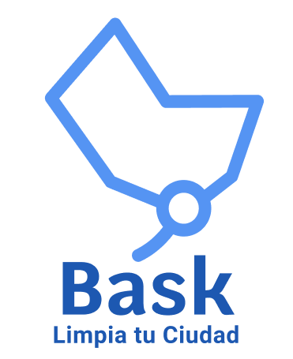

# Bask UI
This repository considers the evidence GA6-220501096-AA3/AA4-EV01 from ADSO at SENA 2026.

### Acceptance Criteria
1. Input Validations such as format and length are included.
2. Router navigation between different views.
3. Responsive design is applied.
4. Fidelity with previous mocks already delivered.

### Evidence

